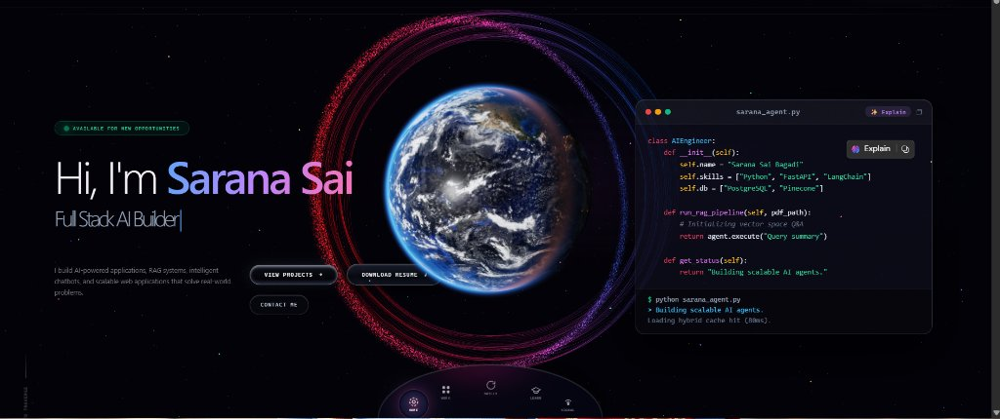

# Interactive 3D WebGL Portfolio & Animations Showcase

**Live Deployment:** [https://3d-animations-portfolio.vercel.app/](https://3d-animations-portfolio.vercel.app/)



A custom-crafted interactive 3D WebGL portfolio and modular animation playground built from scratch by **Sarana Sai Bagadi** with **AI** — combining a full-screen reactive particle cosmos, an interactive WebGL Earth hero, scrollytelling project cards, symbiote liquid CTA buttons, and a 10-box live animation showcase with a side-by-side live viewport & source inspector.

---

## Architecture & Animation Modules

Every animation in this repository is built as a standalone vanilla ES module with zero UI framework runtime dependencies:

| # | Animation | Module | Mount Function | Scene Factory (Optional) | Interactions |
| --- | --- | --- | --- | --- | --- |
| Hero | Interactive 3D Earth | `terra-dusk-vanilla.js` | `mountTerraDusk` | Custom WebGL | Drag to spin, hover orbit tilt, cursor sunlight sweep |
| 01 | Chromatic Tornado | `tornado-vortex.js` | `mountTornadoVortex` | `createTornadoScene` | Drag to orbit, scroll to zoom, color palettes |
| 02 | Ribbon Sphere | `ribbon-sphere.js` | `mountRibbonSphere` | `createRibbonSphereScene` | Drag to rotate, scroll to zoom, depth-shaded helix |
| 03 | Radial Pinburst | `radial-pinsphere.js` | `mountRadialPinsphere` | `createPinsphereScene` | Hover pin repulsion, click pulse wave, drag orbit |
| 04 | Spin Galaxy Rings | `galaxy-rings.js` | `mountGalaxyRings` | `createGalaxyRingsScene` | Drag to orbit, scroll to zoom, Keplerian ring twist |
| 05 | Cosmic Repulsion | `stardust-void.js` | `mountStardustVoid` | `createStardustVoidScene` | Cursor repulsion, click shockwave, orbit & zoom |
| 06 | Sentient Glass Bot | `glass-bot.js` | `mountGlassBot` | `createGlassBotScene` | Cursor look & lean, click blink, hold squint, scroll scale |
| 07 | Particle Bloom Daisy | `particle-flower.js` | `mountParticleFlower` | `createParticleFlowerScene` | Hover to bloom from bud, cursor brush, leave to fold |
| 08 | Circular Gallery | `circular-gallery.js` | `mountCircularGallery` | CSS 3D Stage | Scroll/swipe fly-in & infinite 360° spin, hover flip |
| 09 | Accordion Strip | `accordion-strip.js` | `mountAccordionStrip` | `createAccordionStripScene` | Hover/click slice expansion, scroll zoom |
| 10 | Interactive 3D Earth | `terra-dusk-vanilla.js` | `mountTerraDusk` | Custom WebGL | Drag to spin globe, hover orbit tilt, cursor sunlight sweep |
| FX | Venom Symbiote CTAs | `venom-buttons.js` | `initVenomButtons` | Canvas 2D Tendrils | Organic tendril hover wrapping on action pills |

---

## How to Use Any Animation in Your Own Webpage

### 1. Include the Import Map (for Three.js scenes)

Add this once inside your HTML `<head>` so ES modules resolve `"three"`:

```html
<script type="importmap">
  {
    "imports": {
      "three": "./vendor/three/three.module.min.js"
    }
  }
</script>
```

---

### 2. Mount Any Individual Animation into a Container

Each standalone module exposes a `mount*` helper that mounts a full interactive viewport (`ResizeObserver`, pointer controls, scroll wheel zoom, palette switching, and cleanup):

```html
<div id="my-3d-stage" style="width: 100%; height: 520px; border-radius: 18px; overflow: hidden;"></div>

<script type="module">
  import { mountGlassBot } from './glass-bot.js';

  const stage = document.getElementById('my-3d-stage');
  const instance = mountGlassBot(stage);

  // Optional: cycle color palettes from any button
  console.log('Active palette:', instance.getPaletteName());
  // instance.cyclePalette();

  // Optional: clean up WebGL resources and listeners when unmounting
  // instance.destroy();
</script>
```

Works identically with any of the other animations:

```js
import { mountTornadoVortex } from './tornado-vortex.js';
import { mountRibbonSphere } from './ribbon-sphere.js';
import { mountRadialPinsphere } from './radial-pinsphere.js';
import { mountGalaxyRings } from './galaxy-rings.js';
import { mountStardustVoid } from './stardust-void.js';
import { mountParticleFlower } from './particle-flower.js';
import { mountAccordionStrip } from './accordion-strip.js';
```

---

### 3. Render Multiple Live Thumbnails with One Shared WebGL Context

Browsers cap active WebGL contexts per tab (typically ~8–16). To render many live animated preview cards simultaneously without hitting context limits, use `sharedCardStage` from `shared-card-stage.js` (uses a single shared offscreen `WebGLRenderer` with scissor viewport blitting):

```html
<div id="preview-1" style="width: 280px; height: 180px;"></div>
<div id="preview-2" style="width: 280px; height: 180px;"></div>

<script type="module">
  import { sharedCardStage } from './shared-card-stage.js';
  import { createTornadoScene } from './tornado-vortex.js';
  import { createParticleFlowerScene } from './particle-flower.js';

  sharedCardStage.register(document.getElementById('preview-1'), createTornadoScene);
  sharedCardStage.register(document.getElementById('preview-2'), createParticleFlowerScene);
</script>
```

---

### 4. Standalone Earth Hero Globe & Symbiote Buttons

**Interactive 3D Earth (`terra-dusk-vanilla.js`):**

```js
import { mountTerraDusk } from './terra-dusk-vanilla.js';

const globe = mountTerraDusk(document.getElementById('earth-hero'), {
  size: 520,
  sun: 'cursor',
  hover: 6.8,
  drag: true,
  speed: 9.4,
  look: { clouds: 5, lights: 5, atmosphere: '#4F9BFF' }
});
```

**Circular Gallery (`circular-gallery.js`):**

```js
import { mountCircularGallery } from './circular-gallery.js';

const gallery = mountCircularGallery(document.getElementById('gallery-box'), {
  isPreview: false, // enables scroll fly-in, infinite 360° wrap & cursor 3D flip
  count: 25,
  ringRadius: 224
});
```

**Venom Tendril CTA Buttons (`venom-buttons.js`):**

Add the `venom-cta` class to any button or anchor and initialize:

```js
import { initVenomButtons } from './venom-buttons.js';

initVenomButtons();
```

---

## Run Locally

```bash
npm install
npm start
```

Open `http://localhost:4173`.

## Build for Deployment

```bash
npm run build
```

Bundles `index.html`, styles, modules, assets, and minified Three.js builds (`dist/vendor/three/`) into `dist/` for static hosting (configured in `vercel.json`).
